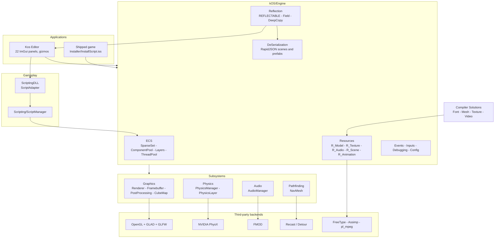
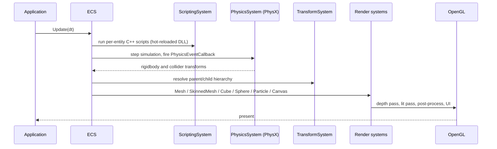

<div align="center">

# KosEngine 2.0

**A 3D game engine and editor written from scratch in C++20 — sparse-set ECS, macro-based compile-time reflection that drives both serialisation and the inspector, PhysX, Recast navmeshes and a custom binary asset pipeline.**


<sub>The Kos Editor running a scene from <code>kOS/Kos Editor/Assets/Scene</code>, built with the bundled Release script on Windows + Visual Studio 2022.</sub>

</div>

---

## At a glance

- **48,175 lines of first-party C++** across the engine, editor and scripting DLL (`kOS/`, excluding vendored dependencies).
- **28 ECS systems over 27 components**, stored in a hand-written sparse set with a thread pool and a layer/collision-matrix system.
- **Compile-time reflection with no RTTI and no code generator** — one `REFLECTABLE` macro per component gives JSON serialisation, deep copy and an editor inspector from a single declaration.
- **A 22-panel editor**: hierarchy, inspector, content browser, animator-controller graph, audio mixer, navmesh baking, post-process settings, performance graphs, gizmos and play/pause.
- **Its own asset pipeline** — four standalone compilers (font, mesh, texture, video) bake source assets into engine-native binaries, with an Inno Setup installer for shipping builds.
- **CI on every push**: GitHub Actions configures with CMake, builds both Debug and Release on `windows-latest`, and runs the GoogleTest binary with XML output.

---

## Highlights

**Reflection without RTTI or a code generator.**
`kOS/Engine/Reflection/Reflection.h` implements a recursive `FOR_EACH` / `COUNT_ARGS` macro pair (the Mazieres expansion trick) so a single `REFLECTABLE(...)` line on a component expands into a compile-time member list. `ApplyFunction` then walks that list generically, which is what lets one declaration feed JSON serialisation (`DeSerialization/`), deep copy (`DeepCopy.h`) and the editor's property grid (`EditorReflection.cpp`). Adding a field to a component requires no second edit anywhere else.

**ECS built on a sparse set, not a map.**
`ECS/SparseSet.h` backs every component pool with dense arrays, so systems iterate contiguous memory instead of chasing pointers. `ComponentPool.h`, `Layers.h` and `ThreadPool.h` sit on top; the 28 systems in `ECS/System/` are the only places that touch component data.

**The editor is a client of the engine, not part of it.**
`kOS/Engine` builds as a library with no ImGui dependency. The editor links it and adds 22 ImGui panels, ImGuizmo manipulators, an ImPlot performance view and an imgui-node-editor animator graph. The same library is what a shipped game links against — `Installer/` packages exactly that.

**Hot-reloadable C++ gameplay scripting.**
`ScriptingDLL/` compiles gameplay code into a separate DLL that `Engine/Scripting/ScriptManager` loads at runtime, with a `ScriptAdapter` boundary so engine types cross the DLL edge safely. The Debug build script configures with `-DHOT_RELOAD_BUILD` for that iteration loop.

**Assets are compiled, not parsed at load.**
`Compiler Solutions/` holds four standalone CMake projects — `FontCompiler` (FreeType), `MeshCompiler` (Assimp), `TextureCompiler` and `VideoCompiler` (pl_mpeg) — that bake source art into engine-native binaries. The runtime `Resources/` layer then only has to load and reference-count them.

---

## Architecture

The engine is a static library (`kOS/Engine`) with no editor code in it. The editor and any shipped game are both applications that link it. Assets never reach the runtime in their authoring format — the four compilers run first.



One frame, end to end:



### Repository layout

| Path | Contents |
| --- | --- |
| `kOS/Engine/ECS/` | `SparseSet`, `ComponentPool`, `Layers`, `ThreadPool`, 27 components, 28 systems |
| `kOS/Engine/Reflection/` | `REFLECTABLE` macros, `Field`, `DeepCopy`, invoker interfaces |
| `kOS/Engine/Graphics/` | Renderer, materials, framebuffers, cube maps, particles, post-processing, 65 shader files |
| `kOS/Engine/Physics/` | PhysX wrapper, physics layers, collision event callbacks |
| `kOS/Engine/Resources/` | `R_*` reference-counted resources: models, textures, audio, video, fonts, animations, scenes |
| `kOS/Engine/Pathfinding/` | Recast/Detour navmesh generation and queries |
| `kOS/Kos Editor/` | Editor application: 22 ImGui panels, asset database and file watcher, command history (undo/redo), editor camera |
| `kOS/ScriptingDLL/` | Hot-reloadable C++ gameplay scripts and the adapter layer |
| `kOS/Test/` | GoogleTest suite (`Kos_test.exe`) |
| `Compiler Solutions/` | Standalone font, mesh, texture and video asset compilers |
| `Installer/` | Inno Setup script and redistributables for shipping a build |

The sample project under `kOS/Kos Editor/Assets/` ships **64 scenes** and **220 prefabs** with their materials, animations and audio, so the editor has real content to open on first run.

---

## Testing and CI

`.github/workflows/c-cpp.yml` runs on every push and pull request against `windows-latest`:

```
cmake -S kOS -B kOS/build
cmake --build kOS/build --config Release -- /m
cmake --build kOS/build --config Debug   -- /m
kOS/bin/Release/Kos_test.exe --gtest_output=xml:../test-results/report.xml
```

The GoogleTest binary currently holds **10 tests**, concentrated on the pieces where a silent regression would be hardest to notice:

| Suite | Tests | Covers |
| --- | --- | --- |
| `SparseSetTest` | 5 | ECS storage: insert, erase, iteration, density invariants |
| `DelegateTest` | 3 | Event delegate binding and dispatch |
| `Math` | 1 | Math helpers |
| `SmokeTest` | 1 | Engine boots and shuts down cleanly |

**Known limitation:** the suite is thin relative to the size of the engine — rendering, physics integration, serialisation round-trips and the asset compilers are verified by running the editor, not by tests. Reflection-driven serialisation round-trip tests are the obvious next target, because one generic test would cover every component.

---

## Getting started

### Requirements

- Windows 10/11
- Visual Studio 2022 (Desktop development with C++)
- CMake 3.21 or newer

All third-party libraries are vendored under `kOS/Engine/Dependencies/` (PhysX, FMOD, Assimp, FreeType, GLAD, GLFW, GLM, GLI, Recast/Detour, pl_mpeg, RapidJSON, stb_image, magic_enum, backward) — there is nothing to install.

### Build and run

From the repository root, run one of the bundled scripts (`Build&Run-Release.bat` for performance testing, `Build&Run-Debug.bat` for development and hot reload). Each creates `kOS/build`, configures CMake, builds the whole solution and launches the editor.

To do it by hand:

```bat
cmake -S kOS -B kOS/build -DHOT_RELOAD_BUILD=off
cmake --build kOS/build --config Release
cd kOS\bin\Release
Kos_Editor.exe
```

### Running the tests

```bat
cmake --build kOS/build --config Release --target Kos_test
kOS\bin\Release\Kos_test.exe
```

---

## Roadmap

- [ ] Serialisation round-trip tests driven by reflection (every component, automatically)
- [ ] Physics and rendering integration tests in CI
- [ ] A Vulkan or DirectX 12 backend behind the existing `GraphicsManager` interface
- [ ] Linux build — the renderer is OpenGL + GLFW; the blockers are the PhysX/FMOD binaries and the `.bat` scripts
- [ ] Richer profiling in the editor's performance panel, beyond frame time

---

## Credits

Built on the first [Kos-Engine](https://github.com/jazwinn/Kos-Engine). Developed at DigiPen Institute of Technology (Singapore).

Vendored third-party work: NVIDIA PhysX, FMOD, Assimp, FreeType, GLFW, GLAD, GLM, GLI, Recast and Detour, Dear ImGui with ImPlot / ImGuizmo / imgui-node-editor, RapidJSON, stb_image, magic_enum, pl_mpeg, GoogleTest.
